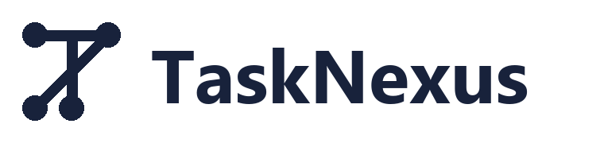
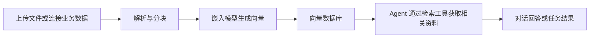

# TaskNexus

**TaskNexus 是一个可自行部署的 AI 应用与多 Agent 任务平台。** 它把模型、业务资料、知识检索、工具和任务配置组织在同一个 Web 工作空间中，让你构建可重复使用的 AI 应用，并管理这些应用的运行过程与结果。

你可以创建一个连接团队知识的对话助手，也可以让多个具有不同职责的 Agent 协作完成研究、分析和内容整理。应用使用者通过对话或任务输入获取结果；应用构建者负责配置模型、知识来源、工具、执行步骤和访问权限。

## 可以用它做什么

| 场景 | 如何使用 TaskNexus | 获得的结果 |
| --- | --- | --- |
| 内部知识问答 | 接入产品文档、操作手册或业务资料，为 Agent 配置知识检索工具 | 能结合相关资料回答问题的 Chat 应用 |
| 研究与分析 | 为资料搜集、信息比较、结论整理配置不同 Agent 和 Task | 有执行记录、任务结果和人工反馈入口的 Crew 应用 |
| 内容与报告整理 | 把提取要点、组织结构、撰写内容拆成任务，传入本次处理的主题与要求 | 可反复运行的处理流程，以及按配置保存的文本结果 |
| 团队应用交付 | 管理成员与资源权限，通过应用链接或 iframe 提供使用入口 | 团队成员或指定使用者可以运行的 AI 应用 |

你可以按应用需求配置模型连接、数据源和工具。知识资料和外部工具按需接入，TaskNexus 负责把这些能力组织成应用，并呈现执行过程。

## 两类应用

| | Chat 对话应用 | Crew 多 Agent 应用 |
| --- | --- | --- |
| 交互方式 | 持续对话，围绕问题逐步获取回答 | 提供本次任务的输入，启动一组任务 |
| 核心配置 | 一个 Agent，以及它的模型、工具和知识来源 | 多个 Agent、Task、任务上下文和执行方式 |
| 执行过程 | 模型根据问题生成回答，按需调用工具和检索知识 | 按顺序或层级方式组织任务，由不同 Agent 执行 |
| 典型用途 | 知识助手、资料查询、交互式分析 | 研究、比较、内容整理、多步骤处理 |

Chat 可以设置对话开场提示。Crew 可以设置任务说明、预期输出、运行输入、人工确认和结构化输出要求；层级执行需要配置管理模型。

两类应用都通过会话呈现运行消息与结果。具体的工具调用和输出能力取决于所选模型及工具适配。

## 产品中的核心对象

理解这些对象之间的关系，可以更容易地搭建应用。

| 对象 | 含义 |
| --- | --- |
| **App 应用** | 使用者进入的入口，类型为 Chat 或 Crew，包含名称、说明和共享设置 |
| **Agent 执行者** | 定义角色、目标、背景、使用的模型和工具；例如资料研究员、分析员、撰稿人 |
| **Task 任务** | 定义要完成的工作、预期输出、执行 Agent，以及需要参考的其他任务结果 |
| **Crew 协作组** | 将 Agent 和 Task 组合起来，指定顺序或层级执行方式 |
| **Model 模型连接** | 保存模型服务与调用配置；对话模型用于生成回答，嵌入模型用于知识向量化 |
| **Datasource 数据源** | 上传的文件或连接器接入的数据，以及解析、同步和知识索引配置 |
| **Tool 工具** | Agent 可调用的能力，包括知识检索、内置联网工具和已配置的函数工具 |
| **Variable 变量** | 可复用的参数，可用于运行输入、任务配置和任务结果传递 |
| **Session 会话** | 一次对话或应用运行的记录，用于查看消息、状态和任务输出 |

Chat 应用绑定一个 Agent；Crew 应用绑定一个 Crew，由其中的任务组织多个 Agent。知识通过检索工具供 Agent 使用，同一个团队中的模型、工具、Agent 和任务可以在不同应用配置中复用。

## 知识接入与检索

TaskNexus 将资料处理成可以被 Agent 检索的知识。它支持上传文件，也可以通过 Airbyte 接入数据库和业务系统的数据。

数据接入后，你可以选择要同步的数据流和字段，配置解析与分块参数，选择嵌入模型及向量数据库，并查看数据源的处理状态、同步时间和记录统计。连接器数据支持手动同步或按界面提供的周期同步。

Agent 使用知识时，会先检索相关资料，再把检索结果作为模型处理问题的上下文。检索工具可以配置返回数量、元数据条件，以及相似度、多查询、自查询等策略；时间加权检索需要相应的时间字段和配置。

**对话模型和嵌入模型承担不同职责。** 对话模型理解问题并生成内容；嵌入模型把资料和查询转换成向量。搭建知识助手时，需要分别配置它们，并保持资料入库与查询使用的嵌入模型和向量维度一致。

## 工具、任务与运行结果

### 为 Agent 配置工具

知识检索工具让 Agent 查询指定数据源。内置工具提供联网搜索、网页内容获取、百科或论文查询等能力，例如 DuckDuckGo、Wikipedia、arXiv、Serper、Apify 和 Firecrawl 适配；部分工具需要独立的服务密钥。

函数工具用于扩展任务处理能力，可以配置 Python 代码、依赖、参数和环境变量。当前可用的执行适配依赖 Google Cloud Functions 及对应凭据；本地执行的状态见下方版本范围。

### 把工作拆成任务

每个 Task 可以指定执行 Agent、任务说明、预期输出、工具及上下文任务。你还可以配置输入表单、变量、人工反馈和结构化输出，使同一组任务接受不同输入并重复运行。

例如，一个资料分析 Crew 可以按以下顺序组织：

| 任务 | 执行 Agent | 输出交给谁 |
| --- | --- | --- |
| 从知识库或已配置的联网工具搜集资料 | 研究员 | 分析员 |
| 对比资料，提取观点与依据 | 分析员 | 撰稿人 |
| 根据分析结果整理报告内容 | 撰稿人 | 应用使用者 |

通过任务上下文关联前面的结果，再选择顺序执行，即可形成这一处理流程。需要由管理 Agent 协调任务时，可以选择层级执行并配置管理模型。

### 查看执行过程与产物

会话界面展示流式回复、任务进度、工具调用状态和等待人工输入的提示。你可以提供反馈、停止生成，并在会话历史中查看运行记录。

任务可以按配置保存输出并提供下载链接。当前文件保存功能保存的是任务的文本结果；结构化输出需要配置相应格式，并使用支持该能力的模型。

## 团队协作与应用共享

资源按组织和团队管理。成员可以被邀请加入团队，角色和权限决定其可创建、编辑、运行或管理的资源。

应用提供团队、私有、指定用户和公开等共享模式，并可以生成应用链接与 iframe 嵌入代码。使用者通过共享入口运行应用时会建立自己的会话；共享设置控制的是应用访问。

项目代码包含成员权限和套餐功能开关，会影响部分共享方式、模型选项和同步频率。自行部署时也需要检查这些配置，实际可用功能以当前组织、角色和后台配置为准。

## 从资料到第一个应用

一条典型的知识助手搭建路径是：

开始前，需要有可访问的 TaskNexus 服务、可用的对话模型连接，以及用于知识索引的嵌入模型和向量数据库连接。云端服务需要对应密钥或凭据；本地服务需要可访问的地址。使用连接器时，还需要配置 Airbyte 与数据源访问凭据。

1. **注册并进入团队空间。** 在当前团队中管理后续创建的资源。
2. **准备知识资料。** 上传文件或配置数据连接器，选择需要处理的数据。
3. **建立知识索引。** 配置嵌入模型和向量数据库，完成同步，确认数据源已就绪。使用本地 Qdrant 时，需要创建指向该实例的“自带向量数据库”（BYO）连接，并将数据源关联到它；这里的“自带”指由你管理的实例，包括本地 Docker 中的 Qdrant。
4. **配置对话模型与 Agent。** 设置角色、目标和模型连接，将需要的检索工具或内置工具交给 Agent。
5. **创建应用并试运行。** 知识问答选择 Chat；多步骤工作选择 Crew，再配置 Agent、Task 和执行方式。
6. **检查结果并交付使用。** 根据试运行调整任务和工具，设置成员访问范围，按需共享或嵌入应用。

如果你要搭建一个 Crew，先明确任务分工、每一步的输入和预期输出，再选择执行 Agent 和上下文关系，会更容易检查流程是否符合实际工作需求。

## 模型与服务接入

| 能力 | 当前项目中的接入方式 |
| --- | --- |
| 对话模型 | OpenAI、Azure OpenAI、Anthropic、Ollama、Groq、Google AI 和 Google Vertex AI 的配置与执行适配 |
| 知识嵌入 | 当前已实现的知识入库与检索链路使用 OpenAI Embeddings 和 FastEmbed |
| 向量存储 | Qdrant 和 Pinecone；连接配置决定具体实例及数据存放位置 |
| 业务数据接入 | Airbyte 连接器，实际目录与可用能力由所部署的 Airbyte 和连接器决定 |
| 文档解析 | Unstructured，用于文件解析及支持的分块处理 |
| Python 函数工具 | 当前执行依赖 Google Cloud Functions 和相应云端凭据 |

模型清单来自项目配置。供应商的模型可用性、工具调用和结构化输出兼容性需要按具体模型确认；对话模型选项不能直接视为同样支持嵌入。当前 Azure/Ollama 嵌入链路仍需完善。

## 当前版本的范围

- **知识解析：** 配套本地解析服务使用 Unstructured 0.1.15，已验证文本和 PDF 的基础解析、按标题分块及 PDF 自动解析/表格推理；界面中的按页、按相似度分块选项尚未被该服务支持。其他解析服务的能力以其实际版本和配置为准。
- **任务编排：** 当前应用使用 Crew 的顺序和层级执行。流程画布页面属于原型，尚未形成完整的流程保存与执行能力。
- **周期运行：** 已有周期能力用于数据源同步；Crew 应用当前通过用户启动运行。
- **函数执行：** 本地函数执行尚未完成；云端函数工具需要对应服务配置。
- **数据流向：** 用户、应用、会话和存储可以由自己的部署管理。云端模型、外部数据源和联网工具会调用对应服务；当前本地 Docker 部署仍可能访问这些外部服务。完全离线运行需要另行准备本地模型等依赖，并逐项确认所选功能的依赖，当前项目未提供完整离线运行保证。

## 系统组成

| 组件 | 技术栈 | 产品职责 |
| --- | --- | --- |
| `webapp/` | Next.js、React、Express、Socket.IO | 应用配置与使用界面、账户和团队、会话、资源管理及同步服务 |
| `agent-backend/` | Python、LangGraph、CrewAI | 执行 Chat/Crew，调用模型和工具，处理任务上下文、人工输入及结果 |
| `vector-db-proxy/` | Rust、Actix Web | 处理接入数据，连接文档解析、嵌入模型与向量数据库 |

MongoDB 保存应用配置和业务记录；Redis/BullMQ 协调应用执行任务；RabbitMQ 在本地部署中承载数据接入消息；Unstructured 和向量数据库支撑知识处理链路。Airbyte 负责连接器数据同步。

Python 执行服务包含本地维护的 CrewAI 包，位于 `agent-backend/vendor/crewai`，用于连接 TaskNexus 的实时消息、人工反馈和任务回调。

## 本地使用与配置

配套本地 Docker 环境运行后，应用入口为 [http://localhost:3000](http://localhost:3000)，Airbyte 管理入口为 [http://localhost:8006](http://localhost:8006)。

配套环境的启动、停止、持久数据和维护方法见 [本地 Docker 使用说明](LOCAL_DOCKER.md)。该说明记录了已构建镜像并完成初始化的本地环境；在新电脑上部署时，需要先准备 Docker、应用镜像、Airbyte、文档解析服务和自己的配置。

配置模板见 [.env.example](.env.example) 与 [webapp/.env.example](webapp/.env.example)。对话模型、外部数据源和需要密钥的工具应使用自己的连接信息；邮件、OAuth、支付和云服务按需配置。品牌及公开链接配置更改后需要重新构建 Web 镜像。

## 开发与贡献

- [Webapp 说明](webapp/README.md)：界面、API、同步服务与环境配置。
- [Agent Backend 说明](agent-backend/README.md)：Python 执行服务及本地 CrewAI 扩展。
- [Vector Proxy 说明](vector-db-proxy/README.md)：知识数据处理与向量代理。
- [贡献指南](CONTRIBUTING.md)：开发流程与验证要求。
- [变更记录](CHANGELOG.md)：项目已有的版本与功能变更。

依赖版本以各组件的清单和锁文件为准。
